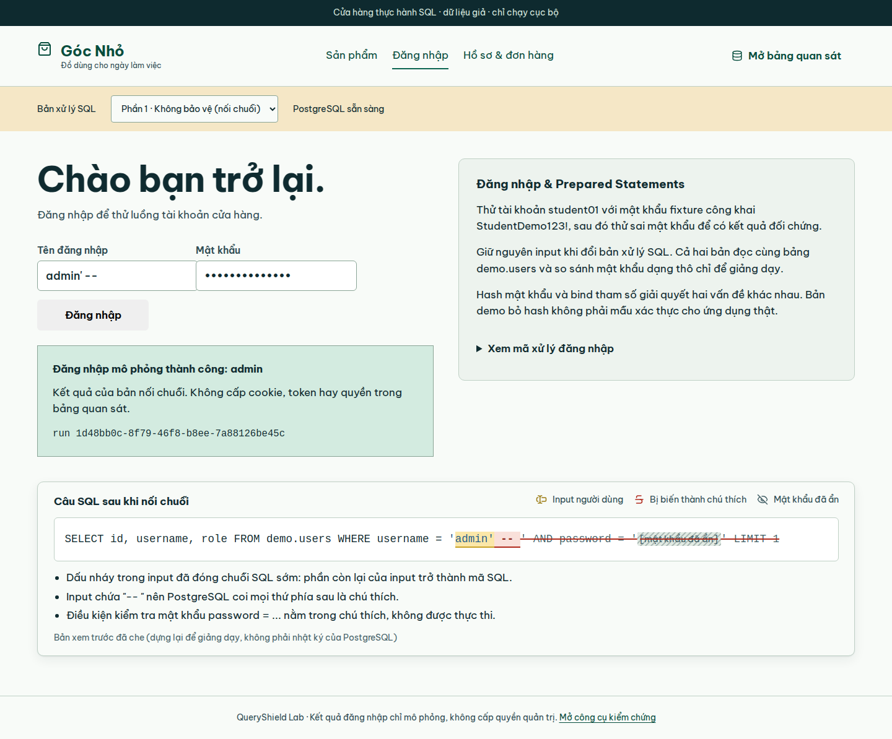
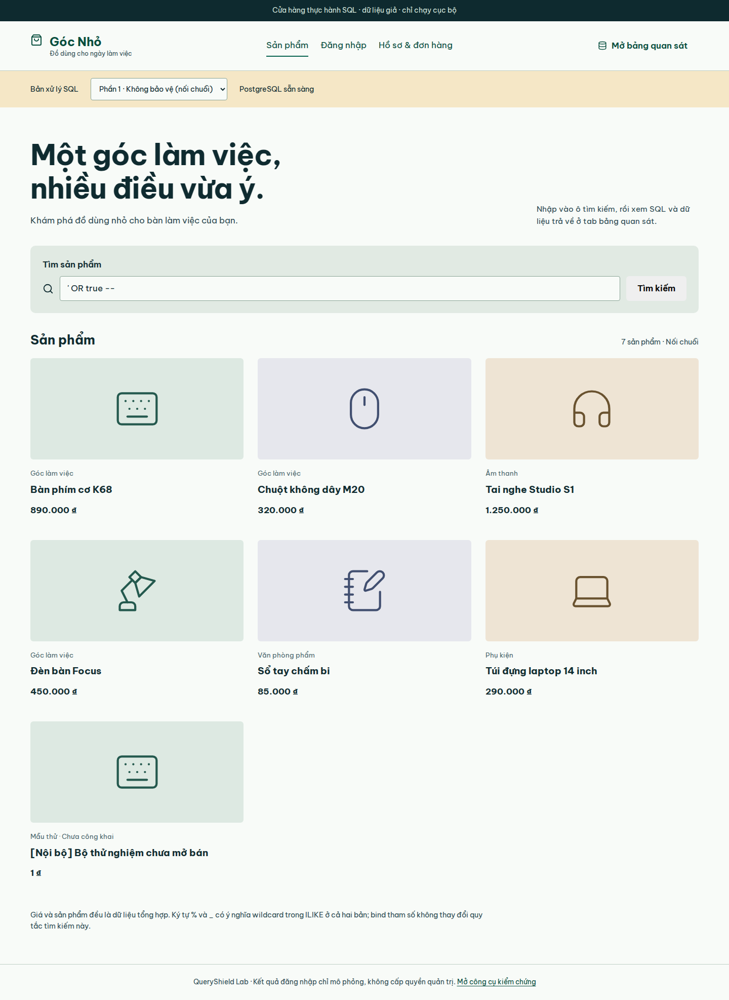
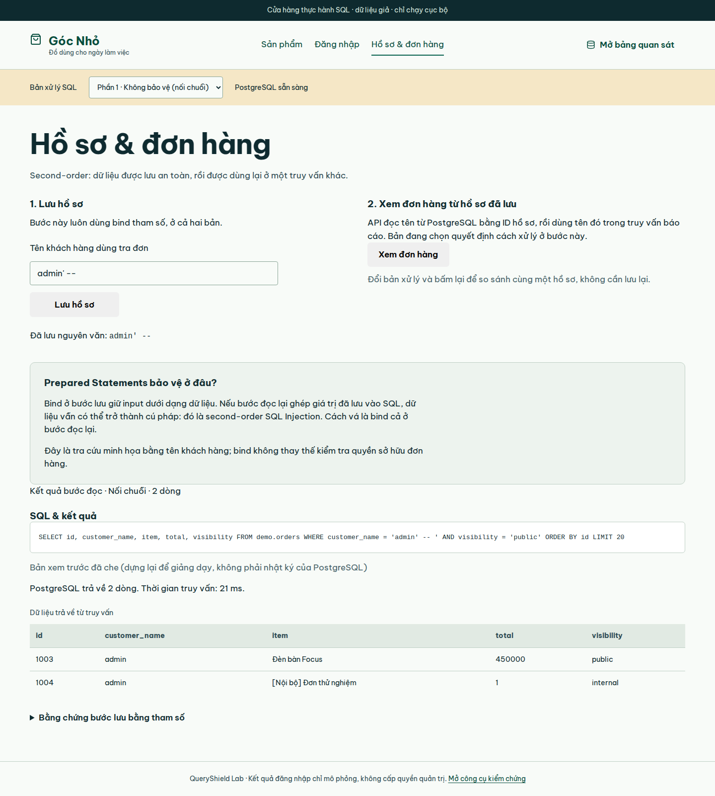
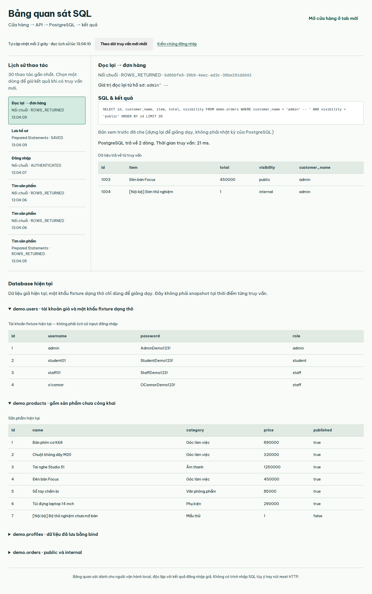
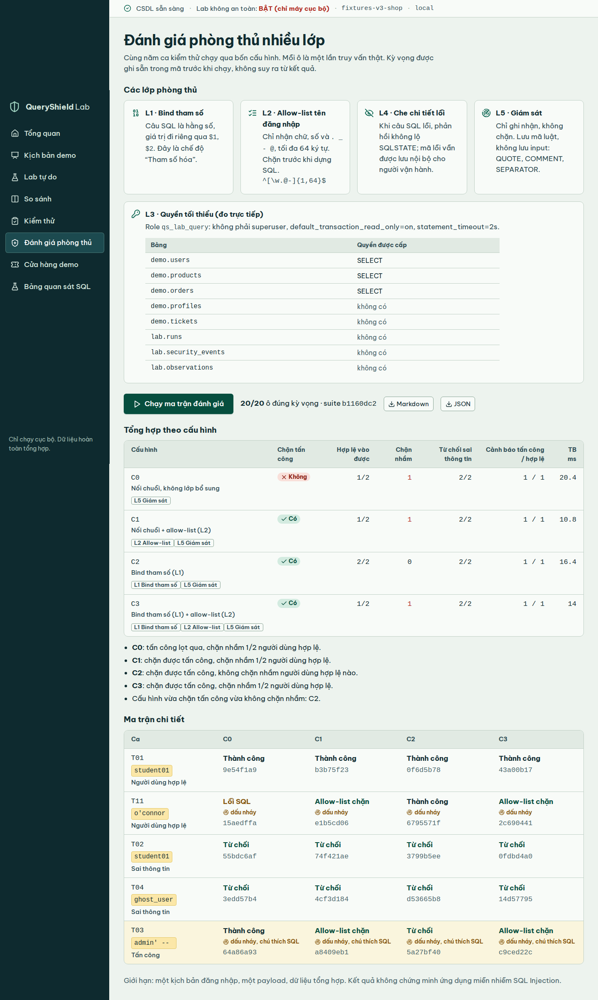
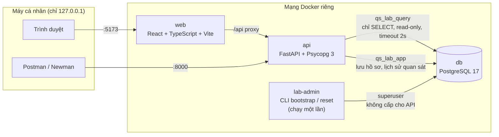
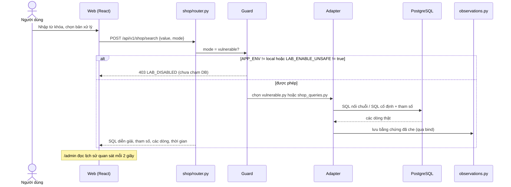

# QueryShield Lab

**Phòng thí nghiệm SQL Injection chạy trên máy cá nhân:** tấn công, phòng thủ rồi kiểm chứng lại trên cùng một cơ sở dữ liệu PostgreSQL thật.

Đồ án môn *Bảo mật và An toàn hệ thống thông tin*. Mục tiêu là cho người xem thấy **nguyên nhân gốc** của SQL Injection, chứ không chỉ một ảnh chụp "bypass login". Hai bản code chạy cùng câu SQL, cùng dữ liệu, cùng input, và chỉ khác một điểm: **nối chuỗi** hay **bind tham số** (Prepared Statements, Psycopg 3).

> [!WARNING]
> Đây là công cụ học tập, **chỉ chạy cục bộ**. Repo cố ý chứa một file có lỗ hổng SQL Injection (`vulnerable.py`). Không triển khai lên máy chủ public, không trỏ vào hệ thống thật. Toàn bộ dữ liệu, tài khoản và mật khẩu đều là dữ liệu giả.



## Mục lục

- [Project minh họa điều gì](#project-minh-họa-điều-gì)
- [Ảnh chụp màn hình](#ảnh-chụp-màn-hình)
- [Kiến trúc](#kiến-trúc)
- [Khác biệt duy nhất: nối chuỗi và bind tham số](#khác-biệt-duy-nhất-nối-chuỗi-và-bind-tham-số)
- [Chạy thử](#chạy-thử)
- [Kiểm thử](#kiểm-thử)
- [Ranh giới an toàn](#ranh-giới-an-toàn)
- [Cấu trúc thư mục](#cấu-trúc-thư-mục)
- [Tài liệu](#tài-liệu)

## Project minh họa điều gì

Ứng dụng mục tiêu là **Góc Nhỏ**, một cửa hàng online giả lập. Ô **Bản xử lý SQL** trên mọi trang cho phép đổi giữa hai bản:

- `Phần 1 · Không bảo vệ (nối chuỗi)`
- `Phần 2 · Prepared Statements`

| Kịch bản | Trang | Input | Bản nối chuỗi | Bản bind tham số |
|---|---|---|---|---|
| Vượt qua đăng nhập | `/login` | tên `admin' -- `, mật khẩu sai | Đăng nhập được vào `admin` | Từ chối |
| Lộ dữ liệu ẩn | `/` | `' OR true -- ` | Trả cả sản phẩm chưa công khai | Không có kết quả |
| Second-order | `/profile` | lưu tên `admin' -- `, sau đó xem đơn | Lộ đơn `internal` của admin | 0 đơn |
| Người dùng hợp lệ có dấu nháy | `/login` | `o'connor` | Lỗi cú pháp SQL | Đăng nhập đúng |

Trang **`/admin`** (Bảng quan sát SQL) tự cập nhật mỗi 2 giây. Mỗi thao tác hiện câu SQL đã tạo, các tham số, các dòng PostgreSQL thật sự trả về, thời gian truy vấn, cùng trạng thái hiện tại của database. Mở cửa hàng và `/admin` ở hai tab để xem tấn công và tác động song song.

Ví dụ second-order cho thấy một điểm hay bị hiểu sai: bước **lưu** đã dùng bind, nhưng bước **đọc lại** giá trị đó vẫn nối chuỗi nên vẫn bị khai thác. Prepared Statements chỉ bảo vệ những chỗ thật sự dùng bind.

Ngoài cửa hàng, project còn có các công cụ kiểm chứng:

- `/demo`: kịch bản trình bày hai phần theo từng bước.
- `/lab/comparison`: chạy cùng một input qua cả hai bản.
- `/lab/test-results`: bộ kiểm thử T01–T09, chạy trên cả hai chế độ.
- `/lab/defenses`: ma trận đánh giá phòng thủ nhiều lớp C0–C3. Gồm bind tham số, allow-list, quyền tối thiểu, che lỗi và giám sát.

## Ảnh chụp màn hình

| Tìm sản phẩm: `' OR true -- ` | Second-order: đọc lại hồ sơ đã lưu |
|---|---|
|  |  |

| Bảng quan sát SQL `/admin` | Đánh giá phòng thủ nhiều lớp |
|---|---|
|  |  |

## Kiến trúc

Hệ thống là một modular monolith gồm bốn container trên một mạng Docker riêng. Mọi cổng chỉ bind vào `127.0.0.1`.



Đường đi của một yêu cầu, ví dụ tìm sản phẩm:



**Công nghệ:** React 19 + TypeScript + Vite · FastAPI + Pydantic + Psycopg 3 · PostgreSQL 17 · Docker Compose · Pytest, Vitest, Playwright, Postman/Newman.

**Hai role database, quyền tối thiểu:**

| Role | Dùng cho | Quyền |
|---|---|---|
| `qs_lab_query` | Chạy SQL của adapter (cả bản lỗi) | Chỉ `SELECT` trên `demo.users`, `demo.products`, `demo.orders`; giao dịch read-only; timeout 2 giây |
| `qs_lab_app` | Lưu hồ sơ, lịch sử chạy, quan sát | Không đọc được cột mật khẩu |

Vì vậy, kể cả khi bị inject, câu SQL của bản lỗi cũng không ghi, xóa hay đọc ra ngoài các bảng giả đã cấp quyền.

Thêm sơ đồ (mô-đun backend, phân quyền, ma trận đánh giá) có trong [docs/diagrams/README.md](docs/diagrams/README.md) và [docs/02-ARCHITECTURE.md](docs/02-ARCHITECTURE.md).

## Khác biệt duy nhất: nối chuỗi và bind tham số

Toàn bộ code SQL nối chuỗi nằm trong **một file duy nhất**: [`adapters/vulnerable.py`](apps/api/src/queryshield_api/modules/laboratory/adapters/vulnerable.py). Bản an toàn nằm ở [`secure.py`](apps/api/src/queryshield_api/modules/laboratory/adapters/secure.py) và [`shop_queries.py`](apps/api/src/queryshield_api/modules/laboratory/adapters/shop_queries.py).

```python
# vulnerable.py: input trở thành một phần cú pháp SQL
def order_query(customer_name: str) -> str:
    return (
        f"{ORDER_COLUMNS} WHERE customer_name = '{customer_name}' "
        "AND visibility = 'public' ORDER BY id LIMIT 20"
    )
conn.execute(order_query(name))
```

```python
# shop_queries.py: câu SQL là hằng số, giá trị được gửi riêng
ORDER_SQL = ORDER_COLUMNS + " WHERE customer_name = %s AND visibility = 'public' ORDER BY id LIMIT 20"
conn.execute(ORDER_SQL, (customer_name,))
```

Với input `admin' -- `, bản nối chuỗi tạo ra:

```sql
SELECT id, customer_name, item, total, visibility FROM demo.orders
WHERE customer_name = 'admin' -- ' AND visibility = 'public' ORDER BY id LIMIT 20
```

Dấu `'` đóng chuỗi sớm, và `--` biến điều kiện `visibility = 'public'` thành chú thích. Ở bản bind, PostgreSQL nhận `admin' -- ` như một giá trị bình thường, rồi tìm khách hàng có tên đúng bằng chuỗi đó.

Project **không** dùng lọc từ khóa hay escape thủ công làm cách sửa. Bind tham số thật là biện pháp chính; các lớp khác chỉ hỗ trợ và được đo riêng ở `/lab/defenses`.

## Chạy thử

**Yêu cầu:** chỉ cần Docker (Docker Desktop, hoặc Docker trong WSL) và Docker Compose v2. Build, cài dependency và test đều chạy trong container.

```bash
git clone https://github.com/thuyduong115/queryshield-lab-SQLi.git
cd queryshield-lab-SQLi
cp .env.example .env          # PowerShell: Copy-Item .env.example .env
```

Mặc định `.env.example` **tắt** bản có lỗ hổng. Để chạy demo tấn công trên máy của bạn, mở `.env` và đặt **cả hai** biến:

```env
APP_ENV=local
LAB_ENABLE_UNSAFE=true
```

Khởi động. Trên Windows, thêm `wsl` trước lệnh nếu Docker chạy trong WSL.

```bash
docker compose --env-file .env -f infra/compose.yaml up --build
```

Compose khởi động PostgreSQL, chạy `lab-admin bootstrap` một lần (tạo schema, role và dữ liệu giả `fixtures-v3-shop`), rồi khởi động API và web. Các cổng mặc định dưới đây có thể đổi trong `.env`:

| Địa chỉ | Nội dung |
|---|---|
| http://127.0.0.1:5173/ | Cửa hàng Góc Nhỏ |
| http://127.0.0.1:5173/admin | Bảng quan sát SQL |
| http://127.0.0.1:5173/lab/overview | Công cụ kiểm chứng |
| http://127.0.0.1:8000/docs | OpenAPI |
| `127.0.0.1:5433` | PostgreSQL (DBeaver, psql) |

Nếu chưa bật hai biến trên, mọi yêu cầu tới bản nối chuỗi trả `403 LAB_DISABLED` trước khi chạm database; bản bind vẫn chạy bình thường.

**Tài khoản giả** để thử: `student01` / `StudentDemo123!`. Payload, kết quả mong đợi và các câu SQL kiểm tra để copy khi demo có trong [docs/script-demo.md](docs/script-demo.md).

**Reset dữ liệu** chỉ làm được qua CLI; không có endpoint HTTP nào cho việc này:

```bash
docker compose --env-file .env -f infra/compose.yaml run --rm lab-admin reset   # khôi phục dữ liệu giả, xóa lịch sử
docker compose --env-file .env -f infra/compose.yaml run --rm lab-admin check   # xem phiên bản dữ liệu và số dòng
```

## Kiểm thử

```bash
bash scripts/test-api.sh    # Ruff + Pytest: unit + tích hợp trên database riêng queryshield_lab_test
bash scripts/test-web.sh    # ESLint + Prettier + Vitest + Vite build
bash scripts/test-e2e.sh    # Playwright trên stack đang chạy (cần APP_ENV=local, LAB_ENABLE_UNSAFE=true)
```

| Bộ test | Nội dung chính |
|---|---|
| Pytest (83 test) | Kết quả hai adapter trên PostgreSQL thật, guard fail-closed, quyền role, migration/reset, lịch sử không chứa mật khẩu, test tĩnh bảo đảm không còn chỗ nào khác nội suy SQL |
| Vitest | Form gửi đúng input, giao diện hiển thị đúng kết quả API trả về, lỗi không bị hiển thị thành thành công |
| Playwright | Đăng nhập, tìm kiếm, second-order, bảng quan sát nhiều tab, bộ T01–T09, ma trận phòng thủ |
| Postman / Newman | 20 request, 54 assertion; xem [tools/postman/README.md](tools/postman/README.md) |

Mỗi kết quả trên giao diện đến từ một truy vấn PostgreSQL thật và có run ID. Không có kết quả nào được suy ra từ việc so khớp chuỗi payload.

## Ranh giới an toàn

- **Một file lỗi duy nhất:** SQL nối chuỗi chỉ có trong `vulnerable.py`. File này chỉ được import khi `APP_ENV=local` **và** `LAB_ENABLE_UNSAFE=true`; thiếu một trong hai thì hệ thống từ chối (fail closed). Cấu hình `LAB_ENABLE_UNSAFE=true` ngoài môi trường local bị từ chối ngay khi khởi động.
- **Chỉ local:** mọi cổng bind vào `127.0.0.1`. Không có endpoint nhận SQL tự do, URL mục tiêu, hay reset qua HTTP.
- **Đăng nhập chỉ là mô phỏng:** vượt qua đăng nhập không cấp cookie, token hay quyền gì trong hệ thống.
- **Không lưu bí mật:** lịch sử quan sát che mật khẩu đã nhập và không lưu body request đăng nhập. Mật khẩu dạng thô trong `demo.users` là dữ liệu giả dùng để so sánh trong lớp học, **không** phải cách lưu mật khẩu nên làm trong hệ thống thật (hãy dùng Argon2id hoặc bcrypt).
- **Giới hạn kết luận:** chặn được vài payload trong một lab không chứng minh ứng dụng miễn nhiễm SQL Injection. Ứng dụng thật còn cần xác thực, phân quyền và kiểm tra quyền sở hữu dữ liệu.

Mô hình đe dọa đầy đủ có trong [docs/06-THREAT-MODEL.md](docs/06-THREAT-MODEL.md).

## Cấu trúc thư mục

```text
apps/api/src/queryshield_api/
  core/                      lỗi chuẩn hóa, guard an toàn
  db/                        schema, dữ liệu giả, kết nối, CLI lab-admin (bootstrap/reset/check)
  modules/laboratory/        service, inspector (diễn giải SQL đã che)
    adapters/vulnerable.py     SQL nối chuỗi (file lỗi duy nhất)
    adapters/secure.py         đăng nhập bind tham số
    adapters/shop_queries.py   SQL cố định cho cửa hàng, bind tham số
  modules/shop/              API cửa hàng: search, profiles, order-report, observations, database
  modules/experiments/       bộ kiểm thử T01–T09, runner, lưu lịch sử quan sát
  modules/defenses/          các lớp phòng thủ L2/L4/L5, đo quyền L3
  modules/evaluation/        ma trận đánh giá C0–C3
apps/web/src/features/
  shop/                      cửa hàng Góc Nhỏ và bảng quan sát /admin
  demo/ comparison/ test-results/ defenses/ laboratory/ overview/
infra/compose.yaml           db, lab-admin, api, web
tests/e2e/                   Playwright
tools/postman/               collection + environment
scripts/                     chạy test, xuất kết quả đánh giá
docs/                        tài liệu thiết kế và kịch bản demo
reports/evaluation/          kết quả đánh giá đã xuất
```

## Tài liệu

| Tài liệu | Nội dung |
|---|---|
| [00-SCOPE](docs/00-SCOPE.md) | Phạm vi và những gì project không làm |
| [01-PRD](docs/01-PRD.md) | Yêu cầu sản phẩm |
| [02-ARCHITECTURE](docs/02-ARCHITECTURE.md) | Kiến trúc chi tiết |
| [03-DATA-MODEL](docs/03-DATA-MODEL.md) | Schema và dữ liệu giả |
| [04-API-CONTRACT](docs/04-API-CONTRACT.md) | Đặc tả API |
| [06-THREAT-MODEL](docs/06-THREAT-MODEL.md) | Mô hình đe dọa |
| [07-TEST-STRATEGY](docs/07-TEST-STRATEGY.md) | Chiến lược kiểm thử |
| [12-SHOP-DEMO](docs/12-SHOP-DEMO.md) | Cửa hàng, bảng quan sát và kịch bản trình bày |
| [script-demo](docs/script-demo.md) | Input, SQL và lệnh để copy khi demo |
| [diagrams](docs/diagrams/README.md) | Bộ sơ đồ Mermaid |
| [11-REFERENCES](docs/11-REFERENCES.md) | Tài liệu tham khảo |

Kết quả đánh giá trong `reports/evaluation/2026-11-13-*` được đo trên bộ dữ liệu cũ `fixtures-v2` (mật khẩu bcrypt). Đó là bản ghi lịch sử, không phải số đo của phiên bản hiện tại.
