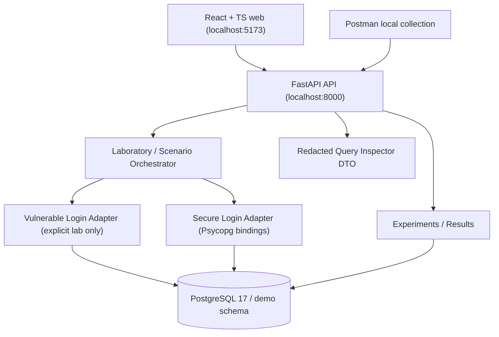
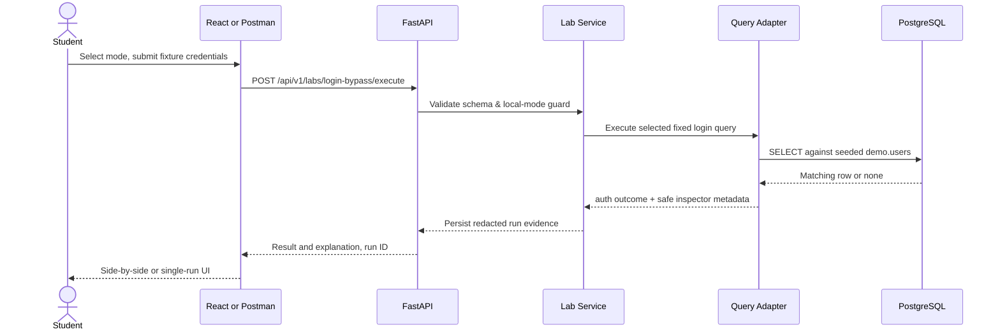

# 02 — Architecture (Modular Monolith)

## Decisions
- Single frontend website, single FastAPI backend, single PostgreSQL **database**; modular architecture instead of microservices.
- Browser communicates only with FastAPI JSON API. Client never sends SQL directly to database.
- Laboratory service selects one of two explicit adapters for a fixed scenario, not arbitrary SQL or arbitrary remote URL.
- The operator/lab control plane is separate from simulated SecureDesk authentication outcome.



## Bounded modules (suggested layout)
```
apps/api/src/
  main.py
  core/                  # config, security guards, error model
  db/                    # connections, roles, migration/seed helpers
  modules/
    laboratory/
      router.py           # HTTP boundary, request/response DTOs
      service.py          # mode dispatch, known scenarios
      adapters/
        vulnerable.py     # the ONLY intentionally insecure query
        secure.py
      inspector.py        # explanatory metadata, secret redaction
    experiments/          # test cases, evidence and history
    reports/              # later, summary of persisted evidence
apps/web/src/
  app/                    # router and providers
  features/laboratory/    # mode, input, result, inspector
  features/comparison/    # before/after display
  features/test-results/  # batch evaluation
  components/             # reusable view primitives
```

## Single-run sequence


## Login adapter semantics
- Both modes have identical selected columns, data and password check, differing **only in construction/binding of values**.
- Educational demo password check uses `pgcrypto` bcrypt inside SQL (`password_hash = crypt(input_password, password_hash)`). This makes a deliberately vulnerable *single SQL statement* capable of bypassing **both** username and password conditions; a backend that queried by username and then verified passwords separately would not demonstrate this same bypass. It is NOT a recommendation to implement production authentication this way; for a real app use a modern application-level password verifier and defense-in-depth.
- In vulnerable adapter, values are concatenated into **one single-line SELECT** so that `--` comments out remaining password check. This is the only exception to safe-query rules. The DB credential has SELECT on `demo.users` only and short statement timeout, with no general SQL endpoint.
- In secure adapter, call `cur.execute(SQL_TEMPLATE, (username, password))`, using `%s` placeholders; never interpolate into SQL before execute.
- If actual driver behavior differs or Postgres configuration prevents the scenario, correct the experiment setup in the dedicated adapter and tests; do not simulate the expected outcome.

## Query Inspector contract
- `sql_template`: human-readable query structure (no input secrets), mode-specific.
- `sql_preview_redacted`: **derived sanitized view** of query shape used for teaching. It must be labeled `redacted preview`, not raw DB trace.
- `parameters`: in secure mode only, names and types / redacted values; never raw password.
- `reason`: factual explanation of why auth succeeded/failed. Do not label a string reconstructed in UI as the SQL executed by PostgreSQL.
- Correlate inspector metadata with `run_id` and actual code path. No fake success state.

## Deployment boundary
- `infra/compose.yaml`: web and API bind only `127.0.0.1` on host; Postgres remains in private Compose network (optional `127.0.0.1:5433` access for DBeaver, disabled by default if possible).
- Two DB users: privileged migration/seed (used from CLI only) and runtime lab **read-only** role; persisted run records use a separate narrowly privileged role/connection or separate storage module, not the vulnerable adapter's DB role.
- `LAB_ENABLE_UNSAFE=false` default. Vulnerable execution requires BOTH `APP_ENV=local` and `LAB_ENABLE_UNSAFE=true`; refuse otherwise. No arbitrary query API.
- Reset via `tools/reset_lab.py` invoked by local operator, not an HTTP endpoint.

## Dependencies and architecture boundaries
- `router` -> `service` -> `adapter`; adapter must not depend on web framework.
- `experiments` can call lab service but must not expose user-supplied SQL.
- `web` never embeds credentials other than known disposable example fixtures and no real secrets.
- Postman is manual API inspection tool; DBeaver is the SQL/database inspection tool.
