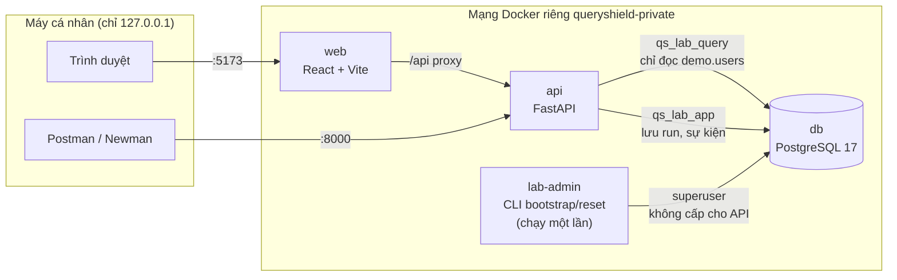
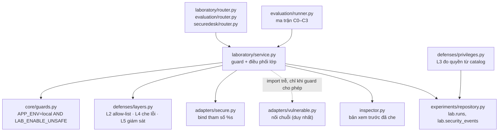
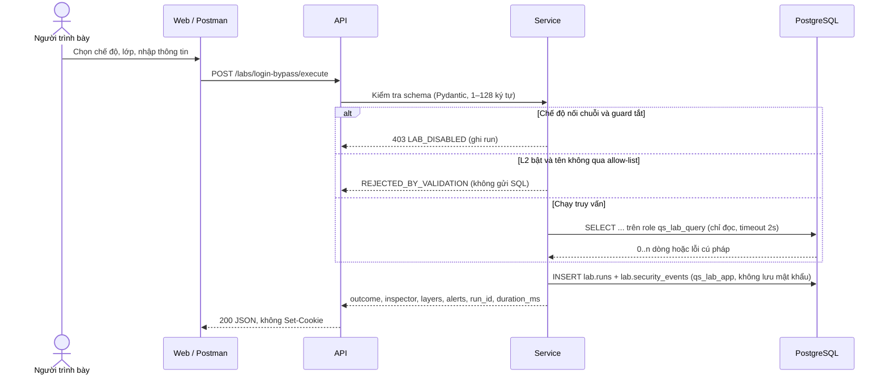
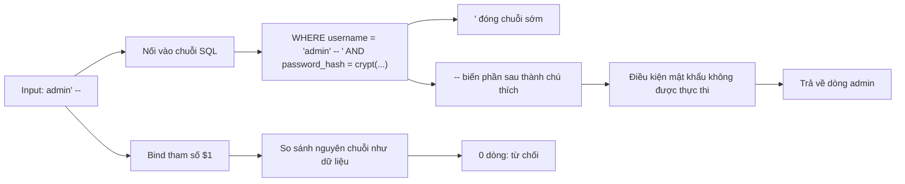
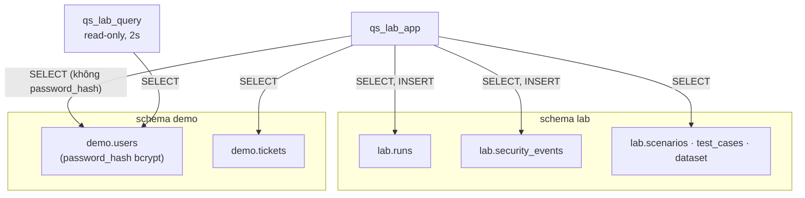
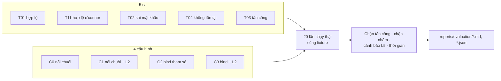

# Sơ đồ

Các sơ đồ viết bằng Mermaid, hiển thị trực tiếp trên GitHub và VS Code. Khi đưa vào báo cáo Word, xuất ảnh bằng [Mermaid Live Editor](https://mermaid.live) hoặc `mmdc`.

## 1. Kiến trúc triển khai cục bộ

## 2. Mô-đun backend

## 3. Trình tự một lần chạy

## 4. Vì sao payload vượt được đăng nhập

## 5. Ranh giới phân quyền cơ sở dữ liệu

## 6. Thiết kế ma trận đánh giá

